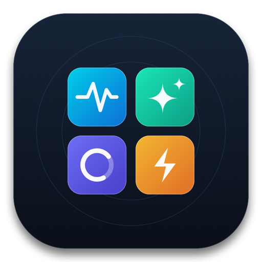

<p align="center">
  
</p>

<h1 align="center">MonoHub</h1>

<p align="center">
  <strong>Unified Native Utility Suite for macOS</strong><br />
  Dynamic Notch, Window Switcher, Window Tiling, System Monitor, AI Quotas, Screenshots &amp; Screen Recording, Media Converter, Display &amp; Audio Control, Cleanup, and Productivity — in one modular Swift 6.4 app built exclusively for Apple Silicon (ARM64).
</p>

<p align="center">
  
  
  
  
  
  
  <a href="LICENSE"></a>
</p>

---

## Overview

**MonoHub** consolidates eleven native macOS power-user utilities — **MonoNotch**, **MonoTab**, **MonoStats**, **MonoClean**, **MonoTile**, **MonoAiBar**, **MonoShot**, **MonoConvert**, **Display Control**, **Audio Control**, and **Productivity & Clipboard** — into a single, cohesive application written in pure **Swift 6.4** with **macOS 27 Liquid Glass** (`NSGlassEffectView`) surfaces and **Zero Telemetry** (outbound network access is strictly restricted to enabled providers in the AI Quotas module).

### Hybrid Architecture (Main Window + Menu Bar + Notch)

- **Dashboard Command Center**: Opening MonoHub presents an organized sidebar dashboard to configure and operate every module from one place.
- **Smart Hybrid Lifecycle**:
  - While the main window is open, MonoHub appears normally in the Dock.
  - Closing the main window (`⌘W`) automatically hides the Dock icon (`.accessory` policy) and keeps MonoHub running silently and lightly in the **Menu Bar** and **Notch**.
  - Click **Open MonoHub** or **Settings…** from any menu bar panel or notch widget to reopen the main window instantly.
- **Lock-Screen & Sleep Power Hygiene**: All background engines, timers, and animations suspend automatically when your Mac is locked or the display sleeps.

---

## On-Demand Modules (Zero Cost When Disabled)

Every module can be toggled live on the **Modules** page (sidebar or **MonoHub › Modules…**). Disabling a module tears down its underlying engine, not just its UI:

| Module | What stops running when disabled |
| :--- | :--- |
| **System Monitor** | Kernel sampling timers, menu bar widgets, and telemetry panels |
| **Dynamic Notch** | Notch windows, media/audio/brightness observers, HUD interception, camera, timers |
| **Window Switcher** | Keyboard event tap, `ScreenCaptureKit` thumbnail cache, menu bar icon |
| **AI Quotas** | Provider network polling, periodic refresh timers, menu bar icon |
| **Window Tiling** | Global hotkeys, edge-drag monitor, modifier drag, menu bar icon |
| **Screenshots** | Global capture hotkeys and menu bar icon (overlay, editor, and OCR exist only during capture) |
| **Media Converter** | Hides the tool (strictly on-demand transcoding, zero background cost) |
| **Display Control** | Opt-in (off by default); zero DDC/CI I2C traffic, gamma tables, overlays, or virtual displays |
| **Audio Control** | CoreAudio device/per-app volume observers and menu bar controls |
| **Productivity & Clipboard** | Snippet expansion event tap, AppleEvent URL interceptor, global Bluetooth hotkey |
| **Cleanup & Uninstaller** | Hides the tools (zero background cost) |

Inside **Dynamic Notch**, each sub-feature (Music, Calendar, Reminders, Bluetooth, Battery, Camera Mirror, File Shelf, Clipboard, Teleprompter, Timer, and HUDs) also starts and stops its own engine independently.

---

## Integrated Modules

### 1. AI Quotas (`MonoAiBar`)
- Real-time usage and rate-limit tracking for **Claude**, **Codex**, **Antigravity**, **Copilot**, **Cursor**, **DeepSeek**, **Kimi**, **GLM**, and more — without sending prompts or consuming tokens.
- Customizable menu bar icon (progress ring, numeric value, abbreviation, or stacked style) with **drag-to-reorder provider priority**.
- Liquid Glass popover with per-provider cards, consumption pacing, remaining balance/credits, and Claude Code context tracking.
- Usage threshold and rate-limit reset notifications; credentials stored exclusively in the **macOS Keychain**.
- The **only** module that accesses the network, strictly for enabled providers.

### 2. Dynamic Notch & Dynamic Island (`MonoNotch`)
- **Native Dynamic Island**: Spring-animated pills at 120Hz ProMotion on physical MacBook notches plus a **floating Virtual Notch** for external and ultrawide monitors (including simultaneous multi-display modes).
- **Media Live Activities & Equalizer**: Album art and animated equalizer in the closed notch; expanded player with interactive scrubber, playback controls, and volume.
- **AI Quotas & Heavy Process Wings**: Live notch wings showing primary AI quota consumption (**Claude**, **Codex**, **Antigravity**) and CPU spike / thermal alerts, plus subtle **Peek Alerts** on quota resets or SoC thermal spikes.
- **Calendar, Meetings & Reminders**: Real-time `EventKit` schedule sync with 1-click join buttons for Zoom, Google Meet, Microsoft Teams, Webex, and FaceTime, plus an interactive Apple Reminders checklist with inline task creation.
- **Camera Mirror & Studio Controls**: Low-latency `AVCaptureSession` webcam preview with **Center Stage**, **Studio Light**, **Portrait Mode**, **Ring Light**, **EV Exposure**, **3×3 Grid**, and **Zoom** — immediately powered off when the notch closes (turning off the green LED instantly).
- **Battery, Power & Bluetooth Accessories**: Live battery telemetry, power source, charging estimate, and battery levels for AirPods (L/R/Case), BLE mice, keyboards, and headphones via `IOBluetooth` and `IOKit.ps`.
- **File Shelf & Instant AirDrop**: Drag files onto the notch to stage them temporarily and share via AirDrop.
- **Clipboard Manager**: Instant search and type filters (`All`, `Text`, `Links`, `Colors`, `Images`, `Pinned`), persistent pins, contextual **Open** actions (Preview, Browser, `NSColorPanel`, Finder, TextEdit), configurable click behavior (Paste / Open / Copy), drag-and-drop, and automatic exclusion of password-manager / concealed items (`org.nspasteboard.ConcealedType`).
- **Teleprompter & Scratchpad**: Positioned directly beneath the FaceTime camera for natural eye contact during calls and recordings, with adjustable **Auto-Scroll** (`pt/s`), Spacebar pause/resume, **Eye Contact Sightline Guide**, word count & speaking-time estimate (~130 wpm), 1-click templates, **Pin Open**, and horizontal optical mirroring for beam-splitter glass.
- **Compact HUD Replacement**: Replaces macOS square overlays with sleek notch pills for Volume, Display Brightness, and Keyboard Backlight.

### 3. Window Switcher (`MonoTab`)
- **High-Speed Switcher (`⌥ Tab` & `⌘ Tab`)**: Instant window cycling via `⌥ Tab`, `⌘ Tab`, or both, with arrow keys, Vim (`h`, `j`, `k`, `l`), numeric jumps (`1`–`9`), and `Shift + Tab`.
- **Live `ScreenCaptureKit` Thumbnails**: GPU/CPU-accelerated 2× Retina previews stored in an ephemeral RAM cache (`ThumbnailStore`) with automatic purge on window close.
- **Instant Fuzzy Search (`f` or `/`)**: Filter open windows by title or app name without leaving the HUD.
- **Quick Look & Direct Window Actions**: Press `Space` for high-resolution preview; `W` (close with confirmation), `⇧W` (hide app), `M` (minimize/restore), `Z` (zoom/maximize), `[` / `]` (snap left/right), and `N` (move to next display).
- **Liquid Glass Themes**: Centered floating panel or fullscreen layout with 7 accent colors and automatic thumbnail scaling.

### 4. System Monitor, Ports & Battery Health (`MonoStats`)
- **Kernel-Direct System Monitor**: Zero subprocesses; reads directly from Mach/Darwin and IOKit with Liquid Glass menu bar widgets and live dashboard views:
  - **CPU**: Overall, user/system split, Load Average, Apple Silicon P-Core / E-Core topology, and Top Processes.
  - **Memory (RAM)**: Activity Monitor parity (App, Wired, Compressed, Cached), memory pressure, Swap, and Top Processes.
  - **GPU**: `IOAccelerator` utilization, Renderer/Tiler load, Unified Memory, and active processes.
  - **Disk**: Volume capacity and live Read/Write throughput via `IOBlockStorageDriver`.
  - **Network**: Live download/upload throughput, session peaks, and local IPv4/IPv6 addresses via `getifaddrs` (no external calls).
  - **Battery & Power**: Charge level, state, Power Mode, charge limit (`powerd`), wattage (`PowerTelemetryData`), health, cycles, and Bluetooth accessories.
  - **Thermal Sensors**: Real HID temperature sensors for SoC (avg/max), SSD, and battery.
- **Network Ports & Per-Process Bandwidth (`MonoPorts`)**: Real-time per-process upload/download rates via Darwin `NetworkStatistics` kernel sockets, `Top Consumer` highlight, `With Traffic` / `LISTEN` / `ESTABLISHED` filters, automatic dev-server port recognition (`:3000`, `:5173`, `:8080`, etc.) with 1-click browser open, and modal-confirmed process termination (`SIGTERM` / `SIGKILL`).
- **Battery Health Diagnostics (`MonoBattery`)**: Design vs. Nominal capacity comparison, cycle tracking against Apple's 1,000-cycle rating, historical charge/thermal/wattage charts, configurable preservation alerts (80% plugged in, 100% full, >42°C thermal warning), and Bluetooth peripheral levels.
- **Live Menu Bar Configurator**: Toggle and reorder modules with a live preview across styles (`Gauge`, `Two Lines`, `Symbol over Value`, `Icon Only`, `Bar`, `Battery Percentage`), alert colors, sampling interval, and language.

### 5. Window Tiling & Smart MRU Focus (`MonoTile`)
- **Magnetic Edge Drag Snapping**: Drag windows to screen edges or corners for halves, quadrants, thirds, or maximize, with native **macOS 27 Liquid Glass** snap previews, haptic feedback, and automatic size restoration on unsnap.
- **Smart Focus & MRU Queue**:
  - **Toggle Last Window (`⌃⌥⌘⇥`)**: Instant back-and-forth switching (AeroSpace/i3 style) with automatic fallback if the previous window closed.
  - **MRU Focus Queue (`⌃⌥⌘]` / `⌃⌥⌘[`)**: Session-aware stack traversal (`B → C → D → A`) with a floating Liquid Glass queue HUD.
  - **Swap with Last Window (`⌃⌥⌘↩`)**: Instantly swaps frames between the active window and the previous MRU window.
  - **Directional Focus (`⌃⌥⌘` + Arrows)**: Neighbor-aware focus with MRU tie-breaking, configurable edge fallback, display scoping, and optional cursor follow.
- **30+ Global Shortcuts & High-Performance AX Engine**: Halves (`⌥⇧←/→/↑/↓`) with `1/2 → 2/3 → 1/3` cycling, quadrants (`⌥⇧U/I/J/K`), thirds (`⌥⇧D/F/G`), two-thirds (`⌥⇧E/T`), maximize (`⌥⇧↩`), almost maximize (`⌥⇧␣`), center (`⌥⇧C`), undo (`⌥⇧⌫`), and multi-monitor moves (`⌥⇧⌘←/→`). Batched AX calls, `CGWindowID` lookup, and event-driven `AXObserver` with zero background polling.
- **Modifier Drag & Resize**: Hold `⌃⌥` (or `⌃⌘`, `⌥⌘`) to drag windows from anywhere at 120Hz ProMotion, or right-drag to resize from the nearest corner.
- **Ignored Apps & Spacing**: Per-app exclusions, outer margins (0–32 pt), and inter-window gaps (0–32 pt).

### 6. Screenshots, Scrolling Capture & Screen Recording (`MonoShot`)
- **Precision Capture**: Region capture (with pixel magnifier and `C` HEX color sampler), Z-order window capture (`Space` toggles mode), fullscreen capture on the cursor's display, and local **Vision OCR** straight to the clipboard.
- **Scrolling Capture (`⇧⌘S`)**: Hardware-accelerated continuous frame stitching via `Vision` (`VNTranslationalImageRegistrationRequest`) with intelligent `CGEvent` auto-scroll and live preview up to **32,000 px**.
- **Quick GIF / Micro-Video Recording (`⇧⌘5`)**: Record any screen region to optimized two-pass adaptive-palette **GIF**, **MP4 (H.264)**, or **WebM (VP9)** using Apple Silicon Media Engine (`AVAssetWriter` / `ScreenCaptureKit`).
- **Annotation Editor**: Arrows, curved arrows, rectangles, step numbers, text, destructive blur and pixelate (irreversibly removes underlying detail), undo/redo, zoom, and floating pinned screenshots.
- **Strictly Offline**: Exports strip EXIF/GPS metadata; OCR clipboard items are marked sensitive; standalone MonoShot preferences import automatically on first launch.

### 7. Media Converter (`MonoConvert`)
- **Apple Silicon Media Engine**: Hardware-accelerated video transcoding (`AVFoundation` / VideoToolbox) and fast image optimization (`ImageIO` / `CoreGraphics`) with zero background CPU usage.
- **Dedicated Video Profiles**:
  - *Tablet 720p Fullscreen* (H.264 Main L3.1 + AAC + `+faststart`, ~85% smaller)
  - *Tablet 480p SD* (H.264 Baseline L3.0, ~92% smaller)
  - *Universal MP4 (1080p)*, *Web / Minimal Size*, *HEVC / H.265*, and *Audio Only (M4A / AAC)*
- **Image Optimization**: Convert between **HEIC**, **AVIF**, **WebP**, **JPEG**, **PNG**, and **TIFF** with continuous quality control (10%–100%) and optional EXIF metadata removal.
- **Batch Drag & Drop Queue**: Real-time savings readout (e.g., `-85.2% (120 MB → 17.8 MB)`), configurable output suffix (`_converted`), custom output directory, and **Reveal in Finder**.

### 8. Cleanup, Uninstaller & Maintenance (`MonoClean`)
- **Complete App Uninstaller**: Locates `.app` bundles plus all associated leftovers (`Application Support`, `Caches`, `Preferences`, `Saved Application State`, `Containers`, `Group Containers`, `WebKit`, `HTTPStorages`, `Logs`, `LaunchAgents`) with per-item checkboxes.
- **Orphan Residue Hunter**: Finds and cleans remnants of previously deleted apps.
- **Deep System Clean**: Scans user caches, logs, crash reports, browser caches, developer caches (Xcode DerivedData, Homebrew, npm, pnpm, yarn, cargo, go-build, pip, CocoaPods), old installers, and Trash.
- **Time Machine APFS Snapshot Purger**: Safely lists and removes local Time Machine snapshots (`tmutil listlocalsnapshots /`) to reclaim tens of gigabytes held in System Data.
- **Dev Project Purger & Dev Environments (`MonoEnv`)**: Identifies heavy build folders (`node_modules`, `.build`, `target`, `dist`, `.venv`, `Pods`, `.gradle`) and global developer ecosystems (Xcode, Node/nvm/pnpm/bun, Python/pyenv/pip/uv/Hugging Face, Homebrew, Rust, Go, Docker) with clear separation between *Safe Caches* and *Runtimes*.
- **Duplicate Files & Similar Photos (`MonoDupes`)**: 3-phase exact duplicate scanner (byte size → 64 KB header hash → streaming `CryptoKit` SHA-256) plus Neural Engine visual **Similar Photos** (`VNGenerateImageFeaturePrintRequest`), 1-click smart selection, and Trash-first removal.
- **Startup Items & Services (`MonoStartup`)**: Inspect, toggle, or safely Trash user/global LaunchAgents, LaunchDaemons, and login items while strictly protecting `com.apple.*` system services.
- **Disk Analyzer & System Optimization**: Volume usage breakdown, large file finder (>50 MB to >1 GB), DNS flush, LaunchServices rebuild, inactive RAM purge, QuickLook reset, and Finder/Dock restart.
- **Whitelist & Local Audit**: Protected paths in `~/.config/monohub/whitelist` and local audit log at `~/Library/Logs/MonoHub/operations.log`.

### 9. Display Control (`DisplayControl`)
- **Opt-In & Inert When Disabled**: Disabled by default in **Modules**; when off, zero DDC/CI traffic, gamma tables, overlays, or virtual screens run. When enabled, macOS Space switches never trigger display reconfiguration — only debounced physical topology changes do.
- **Hardware DDC/CI (MCCS v2.2A)**: Control physical backlight brightness, speaker volume, mute, contrast, sharpness (`0x87`), RGB hardware gain (`0x16`/`0x18`/`0x1A`), color presets (`0x14`), input switching (`0x60`), DPMS power (`0xD6`), and factory reset (`0x04`) over HDMI, DisplayPort, Thunderbolt, or USB-C using native media keys.
- **Combined + Sub-Zero Dimming**: Smooth hardware dimming down to the panel's minimum, seamlessly continuing via ColorSync/Gamma tables (`CGSetDisplayTransferByTable`) and click-through dark overlay down to **0% absolute black** (or *Blackout / Soft Disconnect*).
- **XDR / HDR Extra Brightness (100%–200% / up to 1600 nits)**: Unlocks Extended Dynamic Range (EDR) headroom on supported Apple XDR/HDR displays for SDR desktop apps.
- **HiDPI Scaling, Refresh Rate & Rotation**: Switch native Retina HiDPI/LoDPI modes, refresh rates, rotation (`0°`/`90°`/`180°`/`270°`), favorite resolutions, and custom HiDPI modes.
- **Software Color Calibration**: Correlated Kelvin temperature (`2700K`–`9300K`) along the Planckian locus, per-channel RGB gain, software contrast, gamma shift, grayscale filter, and color inversion.
- **Virtual Displays & Hardware PiP**: Create native `CGVirtualDisplay` dummy screens (`16:9`, `16:10`, `21:9`, `32:9`, `4:3`, `3:2`, `9:16` up to 4K/5K HiDPI) and hardware-accelerated `ScreenCaptureKit` Picture-in-Picture / teleprompter streams with mirroring, region crop, opacity, and click-through.
- **Layout Protection & EDID Inspector**: Save/restore multi-monitor anchor positions, inspect 128-byte VESA EDID 1.4 hex dumps, and export macOS `.plist` display overrides.

### 10. Audio Control (`AudioControl`)
- Native CoreAudio output/input device switching, master volume management, per-application audio volume control, and microphone lock/routing.

### 11. Productivity & Clipboard (`Productivity`)
- **URL Router & UTM Stripper**: Strips tracking parameters (`utm_*`, `fbclid`, `gclid`, `si`, `twclid`, `igshid`, `mc_eid`), redirects meeting/workspace links directly to native desktop apps (Zoom, Teams, Figma, Notion, Telegram), supports source-app (`sourceAppBundleID`) and wildcard domain routing rules, and includes a live **Interactive URL Simulator**.
- **System-Wide Text Expansion / Snippets**: Expand keywords (e.g., `!email`, `!meeting`) inline in any macOS app with dynamic variables (`{date}`, `{time}`, `{clipboard}`, `{uuid}`), integrated directly into the Dynamic Notch clipboard `.snippets` filter.
- **1-Tap Bluetooth Quick Connect (`⌥ B`)**: Connect or disconnect favorite AirPods, headphones, or peripherals from anywhere via a Carbon global hotkey with automatic CoreAudio output routing.

---

## Installation

### System Requirements
- **Operating System**: macOS 27.0+
- **Processor**: Apple Silicon exclusively (ARM64 — M1 / M2 / M3 / M4 / M5 or newer)
- **Build Tools**: Xcode with Swift 6.4 toolchain (`xcode-select --install`)

### Build & Install from Source

```bash
git clone https://github.com/joaooliveiratech/MonoHub.git
cd MonoHub

# 1. Generate the high-resolution AppIcon.icns
make icon

# 2. Run the full automated test suite
make test

# 3. Compile, sign, clean legacy installs/caches, and install to /Applications/MonoHub.app
make install
```

### What `make install` Does (Clean Installation Invariant)
1. Compiles the optimized release binary (`swift build -c release --arch arm64`).
2. Assembles and signs `MonoHub.app` with Hardened Runtime and `Resources/Entitlements.plist`.
3. Terminates running instances and removes duplicate or legacy standalone Mono bundles from `/Applications/` and `~/Applications/`.
4. Cleans stale application caches (`~/Library/Caches/com.antigravity.monohub`).
5. Installs exclusively to `/Applications/MonoHub.app` and deletes the intermediate `.app` bundle from the repository root.
6. Creates CLI symlinks in `~/.local/bin` (`monohub`, `monotile`, `monotab`, `mononotch`, `monoaibar`, `monoshot`).
7. Re-registers `/Applications/MonoHub.app` in LaunchServices (`lsregister -f`) and flushes system icon caches.

---

## CLI & URL Schemes

```bash
# Window Tiling
monohub left-half
monotile right-half

# Screenshots, OCR, Scrolling Capture & Screen Recording
monoshot area | fullscreen | window | ocr | scrolling | record
monoshot image.png
```

Supported URL schemes for automation (Shortcuts, Raycast, Alfred, scripts):
- `monohub://tile/left-half`, `monotile://left-half`
- `monoshot://area`, `monoshot://scrolling`, `monoshot://record`
- `monotab://`, `mononotch://`, `monoaibar://`, `monoroute://`, `monosnippet://`, `monobluetooth://`

---

## Project Structure

```text
MonoHub/
├── Package.swift                  # Swift Package Manager manifest (Swift 6.4, macOS 27+)
├── Makefile                       # Build, test, icon, sign, and clean install targets
├── RULES.md                       # Engineering, privacy, versioning, and release rules
├── AGENTS.md                      # Architecture overview and AI agent guidelines
├── PRIVACY.md                     # Zero-telemetry & offline privacy policy
├── Resources/                     # AppIcon.icns, Info.plist, Entitlements.plist
├── scripts/                       # generate_icon.swift
├── img/                           # Application logo and visual assets
├── Sources/
│   └── MonoHub/
│       ├── App/                   # MonoHubApp, AppDelegate, AppInfo
│       ├── Core/                  # FeatureManager, Preferences, Localization (EN/PT), Permissions, Whitelist
│       ├── UI/                    # Dashboard, Sidebar, Modules, Settings, Liquid Glass components
│       └── Features/
│           ├── AIQuota/           # Provider usage models, Keychain services, menu bar & popover UI
│           ├── AudioControl/      # CoreAudio device & per-app volume engine
│           ├── Cleanup/           # Uninstaller, Orphans, SystemClean, Snapshots, DevEnv, Dupes, Startup
│           ├── DisplayControl/    # DDC/CI, Sub-Zero Dimming, XDR, HiDPI, Virtual Displays, PiP, EDID
│           ├── DynamicNotch/      # Media, Calendar, Reminders, Camera, Teleprompter, Clipboard, HUD
│           ├── MediaConverter/    # VideoToolbox / AVFoundation & ImageIO batch converter
│           ├── Productivity/      # URLRouter, Snippets, BluetoothQuickConnect
│           ├── Screenshot/        # ScreenCaptureKit capture, ScrollingCapture, ScreenRecorder, OCR, Editor
│           ├── SystemMonitor/     # Mach/IOKit readers, Sampler, BatteryHealth, Ports & Bandwidth
│           ├── WindowSwitcher/    # EventTap & ScreenCaptureKit ThumbnailStore
│           └── WindowTiling/      # AX engine, EdgeSnap, MRU Focus Queue, global hotkeys
└── Tests/
    └── MonoHubTests/              # 429 automated tests across 56 suites
```

---

## Testing

```bash
make test
```

Runs all **429 tests across 56 suites** via `swift test --arch arm64`, covering feature toggle lifecycles, kernel telemetry readers, battery/lock-screen suspension, window tiling geometry and MRU focus queues, Dynamic Notch sizing and preferences, screenshot rendering/privacy/scrolling/recording, cleanup safety guards, media conversion, display topology, audio routing, and AI quota security compliance.

---

## Privacy & License

- **Privacy Policy**: [PRIVACY.md](PRIVACY.md) — Strict offline-first architecture and zero telemetry.
- **Engineering Guidelines**: [RULES.md](RULES.md) · [AGENTS.md](AGENTS.md)
- **License**: Released under the **[MIT License](LICENSE)**.
